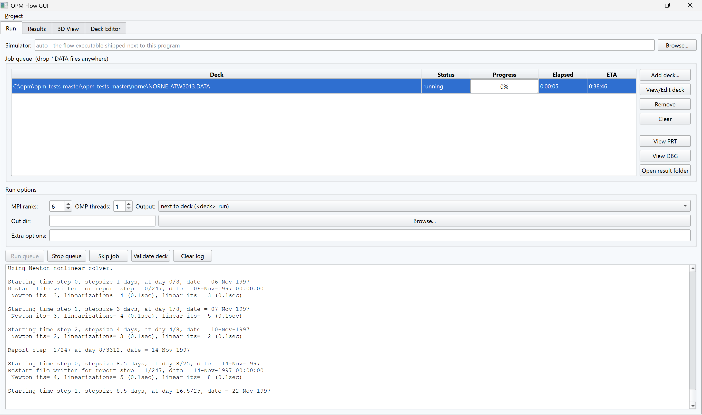
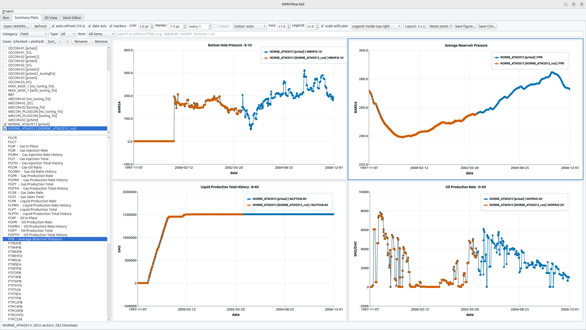
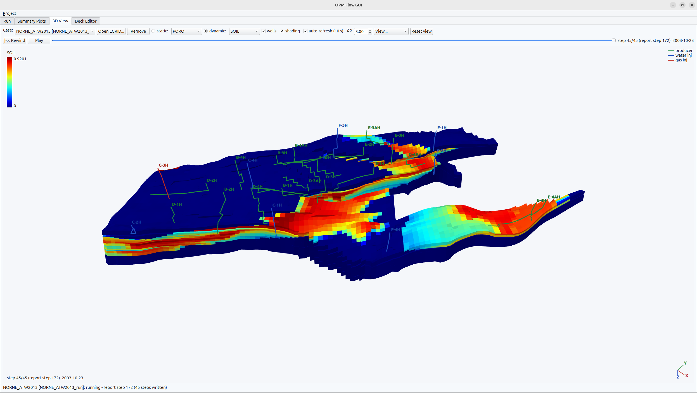
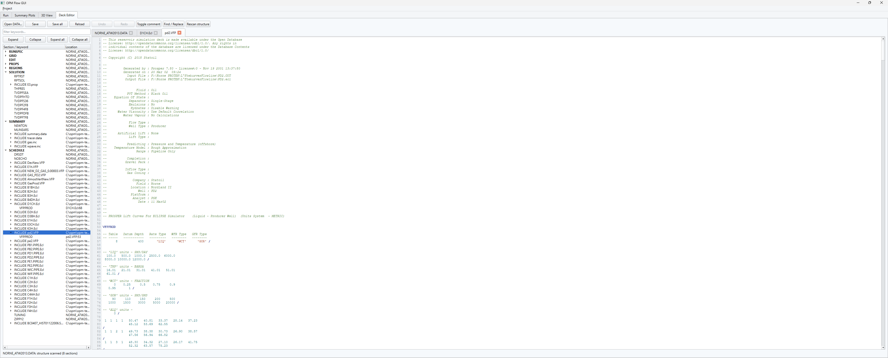

# opm_flow_windows

Build [OPM Flow](https://opm-project.org) as a **pure native Windows binary**
(MSVC PE — no WSL, Cygwin, or MSYS), both **serial** and **parallel (MPI + Zoltan)**.

This repo is just the **build harness**: scripts, the detailed guide, the small
Windows compatibility shims, the DUNE patches, and a CI workflow. It does **not**
contain the OPM / DUNE / Trilinos sources — `build-all.ps1` clones those into
`src/`, `deps/`, and `vcpkg/` (all git-ignored) when you run it.

> Status: what the quick start builds - the pinned OPM sources - is built and run
> on Norne, with MS-MPI and with Intel MPI, every night by
> [CI](#continuous-integration); an open issue labelled `windows-pinned` means
> that build is currently broken. The first clean-checkout walkthrough is in
> [VALIDATION.md](VALIDATION.md).

## flow-gui at a glance
The bundled [flow-gui](flow-gui/) workbench (Windows / Linux / macOS), here on
the Norne benchmark case:

| Run queue with live progress | Summary plotting & case comparison |
|---|---|
|  |  |
| **3D results viewer** | **Deck editor** |
|  |  |

## Prerequisites
- Windows 10/11 x64; `git` and `winget` on PATH; ~15 GB free disk; internet.
- **Toolchain (one-time)** — VS 2022 C++ build tools + Windows SDK + CMake + Ninja
  (approve the UAC prompt):
  ```powershell
  winget install --id Microsoft.VisualStudio.2022.BuildTools -e `
    --accept-package-agreements --accept-source-agreements `
    --override "--quiet --wait --norestart `
      --add Microsoft.VisualStudio.Workload.VCTools `
      --add Microsoft.VisualStudio.Component.VC.Tools.x86.x64 `
      --add Microsoft.VisualStudio.Component.Windows11SDK.22621 `
      --add Microsoft.VisualStudio.Component.VC.CMake.Project `
      --includeRecommended"
  ```
- **For MPI builds only** — Microsoft MPI runtime + SDK:
  ```powershell
  winget install --id Microsoft.msmpi -e
  winget install --id Microsoft.msmpisdk -e
  ```

## Quick start (serial)
From a clone of this repo:
```powershell
.\build-all.ps1
```
Clones vcpkg, DUNE (v2.10.0) and OPM, applies the DUNE patches, installs the
dependencies, and builds in order. Result:
`build\opm-simulators\bin\flow_blackoil.exe`, the black-oil simulator. Run it:
```powershell
.\build\opm-simulators\bin\flow_blackoil.exe <deck>.DATA --output-dir=<dir>
```

**Which OPM this builds:** OPM master of
<!-- opm-snapshot -->2026-10-24<!-- /opm-snapshot --> with the Windows fixes on
top - the commits [opm-sources.json](opm-sources.json) pins, built and run
together, not whatever the forks' `windows` branches hold on the day you clone
(see [Pinned OPM sources](#pinned-opm-sources)). `--version` reports the
development version OPM master carried then, not a release number. The rest is
pinned too: DUNE to 2.10.0, and vcpkg - whose ports decide the version of
every dependency, Boost, fmt, SuiteSparse and the rest - and, for `-Mpi`,
Trilinos (for Zoltan) to the commits `opm-sources.json` names. For the
configuration the release packages ship - every model in one `flow`, MPI +
OpenMP - see
[Build your own copy of the release packages](#build-your-own-copy-of-the-release-packages).

## Quick start (parallel / MPI)
```powershell
.\build-all.ps1 -Mpi
mpiexec -n 4 .\build-mpi\opm-simulators\bin\flow_blackoil.exe <deck>.DATA --output-dir=<dir>
```
Builds Zoltan (from a Trilinos clone) + the MPI modules into separate
`build-mpi\` / `install-mpi\` trees (the serial build is untouched). See
[BUILD_WINDOWS.md](BUILD_WINDOWS.md) §13.

## Quick start (Intel MPI)
An alternative to MS-MPI, built into its own `build-impi\` / `install-impi\`
trees so the MS-MPI build is untouched. Two reasons to prefer it:

- **It needs no administrator rights.** Its runtime installs into your own
  profile, where installing MS-MPI needs an administrator — which is what
  otherwise stops OPM Flow running at all on a managed work laptop, since the
  simulator links an MPI library even for serial runs.
- **It measured faster — on a cool machine.** On Norne, 4 ranks × 2 threads:
  125 s of simulation time against 157 s for MS-MPI, with identical iteration
  counts. Note that the assembly time fell by about as much as the linear solve
  did, and assembly is local compute — so some of that gain is likely Intel
  MPI's default process pinning rather than faster message passing. The
  measurement is only reproducible when the laptop starts cold: after an hour
  of builds the same binaries ranged from 170 s to 253 s run to run, MS-MPI
  and Intel MPI overlapping, and an eight-minute idle did not restore the
  cold-start pace. On the charger but already warm (CPU clocks 68-83 % of
  base under the 8-thread load), a same-day pair gave 272 s for MS-MPI and
  258 s for Intel MPI: the same ordering, 5 % apart, far off the cold pace.
  Measure before relying on the difference.

```powershell
python -m pip install --user impi-rt impi-devel   # no administrator needed
.\build-intelmpi.ps1 -Jobs 8
```
`pip` installs the runtime under `%APPDATA%\Python\Library`, which Windows does
not search, so anything using it has to put that directory on `PATH` first —
`flow-gui` does so for the simulators it launches, and the packaged
`bin\flow-impi.cmd` does it for terminal use.

The Intel MPI runtime is **not** redistributed in the packages: OPM Flow is
GPLv3 and Intel MPI is proprietary, so shipping them together raises a
licensing question this project does not try to answer. Users install it
themselves with the one `pip` command above — the same posture the MS-MPI
package takes by shipping Microsoft's installer rather than `msmpi.dll`.

## Build your own copy of the release packages
The published packages carry `flow` - the one executable with every model
variant - built for hybrid MPI + OpenMP, beside flow-gui:
```powershell
.\build-all.ps1 -Mpi -OpenMP -SimTarget flow -Jobs 4
```
That builds the OPM commits the harness pins (see
[Pinned OPM sources](#pinned-opm-sources)), not whatever the `windows` branches
hold that day. Then build flow-gui against that tree (Qt 6; see [flow-gui/README.md](flow-gui/README.md#windows-this-harness))
and, if you want the zip, installer or MSIX as well, package it.
[docs/release-checklist.md](docs/release-checklist.md) goes through all of it,
from a bare machine to the installer, including the Intel MPI variant.

## Where the OPM Windows fixes live
Upstream OPM does not build with MSVC on its own: the Windows/MSVC fixes to
opm-common/opm-grid/opm-simulators (and opm-upscaling, with `-Upscaling`) must
be in the sources. They are maintained on the `windows` branch of the
[opm-common](https://github.com/GitPaean/opm-common/tree/windows),
[opm-grid](https://github.com/GitPaean/opm-grid/tree/windows) and
[opm-simulators](https://github.com/GitPaean/opm-simulators/tree/windows) forks,
rebased onto upstream master as it moves, and that is what `build-all.ps1`
clones by default (the DUNE patches in `patches/` are applied automatically
either way). Upstream as it is - which compiles with MSVC only once those fixes
are merged there - is one switch away:
```powershell
.\build-all.ps1 -Mpi -OpmOrg OPM -OpmBranch master
```

### Pinned OPM sources
The `windows` branches move with every rebase, and in between a branch head can
be a rebase in progress, or one module rebased onto a master the others have not
caught up with. So `build-all.ps1` does not build the branch heads: it checks
each module out at the commit [opm-sources.json](opm-sources.json) pins - a set
that was built and run together (SPE1 and Norne), the way DUNE is pinned to
`v2.10.0`. A pinned commit stays fetchable after a rebase takes it off the
branch, since GitHub serves commits by id.
```powershell
.\build-all.ps1 -OpmLatest           # the branch heads instead of the pins
.\update-opm-pins.ps1 -Check         # are src\opm-*, vcpkg\ and deps\Trilinos at the pins?
.\update-opm-pins.ps1                # pin what src\opm-* holds now
```
A checkout already in `src\` is never moved - it may be where you work on the
series - but the build warns when it is not at its pin, since it then builds
something other than the verified set. After rebasing the series and checking
the result, `update-opm-pins.ps1` records the new set, and the snapshot date the
quick start above gives; it refuses a commit with local changes or one that is
not pushed to the fork's branch. Commit `opm-sources.json` and README.md with
the harness - or push the rebase and start the
[nightly workflow](#continuous-integration) by hand with **rebase** off, which
pins the heads once it has built them and run Norne:
[docs/release-checklist.md](docs/release-checklist.md) §1 has the whole round.

The same file pins **vcpkg** - its ports decide the version of every dependency
- and **Trilinos**, where Zoltan comes from for `-Mpi`. A new clone fetches just
that commit of each. Trilinos is pinned where the release packages were built;
vcpkg is newer than the one they were built with, which cannot build LAPACK
where Visual Studio 2026 has its C++ Clang tools (see
[BUILD_WINDOWS.md](BUILD_WINDOWS.md) §5).
`update-opm-pins.ps1` carries these pins over as they are; moving them is its
own decision, made after building against the newer ones:
```powershell
.\build-all.ps1 -VcpkgRef master -TrilinosRef develop   # build against their newest
.\update-opm-pins.ps1 -Dependencies   # then pin what vcpkg\ and deps\Trilinos hold
```
An existing `vcpkg\` is not moved either, with a warning when it is not at its
pin - and moving it by hand changes nothing already installed. To bring a tree
to new vcpkg pins, check the commit out
(`git -C vcpkg fetch --depth 1 origin <commit>; git -C vcpkg checkout --detach FETCH_HEAD`),
run `vcpkg\bootstrap-vcpkg.bat`, delete `vcpkg\installed` and run `build-all.ps1`
again; then rebuild DUNE and OPM against what it installed.

## Options
```powershell
.\build-all.ps1 -Mpi                 # parallel build (MPI + Zoltan)
.\build-all.ps1 -OpenMP              # OpenMP threading (/openmp:llvm)
.\build-all.ps1 -Mpi -OpenMP         # hybrid MPI + OpenMP
.\build-all.ps1 -SimTarget all       # build every flow_* variant (full suite), not just flow_blackoil
.\build-all.ps1 -Upscaling           # also clone + build opm-upscaling (upscale_* / cpchop tools)
.\build-all.ps1 -SkipClone           # sources already cloned
.\build-all.ps1 -SkipDeps            # vcpkg packages already installed (still installs any that are missing)
.\build-all.ps1 -Jobs 6              # parallel compile jobs per module (default 4; raise on a high-RAM machine)
.\build-all.ps1 -DuneVersion v2.10.0
.\build-all.ps1 -OpmOrg <user> -OpmBranch <branch>   # default GitPaean / windows
.\build-all.ps1 -OpmLatest           # new clones at the branch heads, not the pinned commits
.\build-all.ps1 -VcpkgRef <ref>      # a new vcpkg clone at <ref>, not the pinned commit (also -TrilinosRef)
```
`-Mpi` and `-OpenMP` are independent and compose. For hybrid runs use
`mpiexec -n <ranks> flow_blackoil <deck> --threads-per-process=<threads>`.

Intel MPI is selected per module rather than through `build-all.ps1`, since it
uses its own build trees:
```powershell
.\build-intelmpi.ps1 -Jobs 8              # the whole chain, Zoltan included
.\build-module.ps1 opm-simulators -IntelMpi -OpenMP -Target flow -Jobs 8
.\package-flow.ps1 -IntelMpi -Zip         # package that build (runtime not bundled)
```

## Continuous integration

The [nightly Windows workflow](.github/workflows/windows-weekly.yml) builds
opm-common, opm-grid and opm-simulators against both MPI implementations. It runs
Norne with **4 MS-MPI ranks x 1 OpenMP thread** and **2 Intel MPI ranks x 2 OpenMP
threads**. The two decompositions exercise MPI and hybrid MPI/OpenMP execution;
the workflow does not compare output arrays with a Linux reference.

Every night it runs two jobs side by side:

- **pinned** - the build a user gets: it clones nothing itself, but runs
  `build-all.ps1` as you would, which checks out OPM, vcpkg and Trilinos at the
  commits `opm-sources.json` pins. The pins move only after a build of the new
  set, so a failure here comes from everything else - the runner image and its
  MSVC 19.51 (newer than most local compilers), the Intel MPI wheels, a download
  a pinned vcpkg port can no longer get - or from a pin update that was only
  checked locally, or by the canary against newer vcpkg and Trilinos.
- **latest** - the canary: the `windows` branch heads, rebased onto that day's
  upstream master, built against vcpkg's master and Trilinos' develop, so a
  break upstream - in OPM or in a dependency - shows up the day it lands. Its
  summary also says, per module, whether the harness pin is the branch head.
  When it built the heads as they are - started after a rebase was pushed,
  before upstream moved, or with **rebase** off - and both Norne runs passed,
  it pins them itself: it runs `update-opm-pins.ps1` and pushes
  `opm-sources.json` and README.md to master.

Both jobs list which vcpkg and Trilinos commits they built from.

Each job keeps its own failure issue (labels `windows-pinned` and
`windows-weekly`), commented on while it stays broken and closed by the next
pass. Started by hand, the workflow runs both jobs or either one (**sources**).

Each job records the harness commit and, per OPM module, the pinned commit and
what it built - for the canary also the cloned fork commit, the fetched upstream
commit and the commit after any rebase - in `source-revisions.json`. Download it
from the `opm-source-revisions-<job>` artifact; it is also included with a
successful `flow-windows-x64-<job>` binary artifact. Once source resolution has
completed, the revision artifact is uploaded even if a rebase conflict or later
build failure prevents a binary from being produced.

## What's in this repo
| Path | Purpose |
|------|---------|
| `build-all.ps1` | One-shot driver — the entry point (serial or `-Mpi`) |
| `build-module.ps1` | Configure/build/install one module with the MSVC flags (`-Mpi`, `-IntelMpi`, `-OpenMP`) |
| `build-intelmpi.ps1` | The whole chain against Intel MPI, into `build-impi\` — no administrator rights needed |
| `setup-env.ps1` | Loads MSVC (vcvars64) + vcpkg (+ MS-MPI) into the shell |
| `compat/include/` | POSIX/Fortran shim headers MSVC lacks (getopt, unistd, sys/*, FCMacros) |
| `patches/` | DUNE Windows patches, auto-applied after the DUNE checkout |
| `opm-sources.json` | The OPM commits `build-all.ps1` checks out: a set verified to build and run together |
| `update-opm-pins.ps1` | Writes `opm-sources.json` from `src\opm-*` after a verified rebase; `-Check` compares |
| `probes/` | Stand-alone programs that each settle one question about the build (MS-MPI spawning, autodiff constants, C++-only package consumption); see its README |
| `build-clang.ps1` | Build one module with clang-cl instead of MSVC, against the same DUNE/vcpkg tree; what the forks' smaller `windows_clang` branches are built with |
| `flow-gui/` | The Qt 6 graphical workbench for flow (Windows/Linux/macOS): run/monitor with live progress, summary plotting & case comparison, 3D results viewer, deck editor, projects (see its README) |
| `package-flow.ps1` | Stage a redistributable package (bin + runtimes + prerequisites) and zip it |
| `installer/` | Inno Setup script producing `OPM-Flow-<ver>-Setup.exe` (see [PACKAGING.md](PACKAGING.md)) |
| `packaging/` | MSIX build script for sideloading / Microsoft Store (see [PACKAGING.md](PACKAGING.md)) |
| `PACKAGING.md` | Distribution guide: portable zip, installer, MSIX/Store, licensing notes |
| `release-notes/` | Per-release notes shown on the GitHub Releases page (e.g. `master-2026-10-12.md`, named after the OPM master snapshot); published with `gh release edit --notes-file` (see [PACKAGING.md](PACKAGING.md)) |
| `ci/windows.yml` | GitHub Actions workflow |
| `.github/workflows/windows-weekly.yml` | Nightly build and Norne runs against both MPI implementations, of the pinned sources and of the branch heads on upstream master, with source revision records |
| `BUILD_WINDOWS.md` | Full step-by-step guide (§1–14): toolchain, deps, flags, MPI, patches, CI |
| `PATCHES.md` | Record of every source-level Windows/MSVC fix |
| `VALIDATION.md` | Clean-room validation walkthrough + results |

Ignored (cloned sources or generated build/packaging output): `src/`, `deps/`,
`vcpkg/`, `build*/`, `install*/`, `dist/` (packaging output — staged trees, the
downloaded VC++/MS-MPI runtime installers, and the built `Setup.exe`/`.zip`/`.msix`),
and `*.log`.

## Installing a released build (Windows SmartScreen)
The published `Setup.exe` / `.zip` are **not code-signed**, so Microsoft
SmartScreen shows a *reputation* warning (not a virus detection) — and it is
dismissible:
- **Downloading (Edge/Chrome):** if it says *"isn't commonly downloaded"*, open
  the download's **⋯** menu → **Keep**, then **Keep anyway**.
- **First launch:** if *"Windows protected your PC"* appears, click
  **More info → Run anyway**.

The `.exe` installer only *warns*; the **MSIX** package, by contrast, is
*blocked* unless its signing certificate is already trusted on the target
machine — so prefer the `Setup.exe` (or the portable zip) for general use.
Code-signing the installer with an OV/EV certificate removes the warnings
altogether (see [PACKAGING.md](PACKAGING.md)).

## License
Copyright (C) 2026 SINTEF Digital, Mathematics & Cybernetics.

This repository (build scripts, documentation, compatibility shims, and the
`flow-gui` application) is licensed under the
**GNU General Public License, version 3 or later** — see [LICENSE](LICENSE) —
matching the [OPM project](https://opm-project.org) it builds. The files in
`patches/` modify DUNE sources and are therefore available under the licenses
of the respective DUNE modules (GPL-2 with runtime exception).

## Notes
- The default target is `flow_blackoil` (far less RAM/link time). Full `flow` —
  the single exe with every model variant, which the release packages ship —
  comes with `-SimTarget flow` (or `-SimTarget all` for the whole suite);
  linking it is memory-hungry, so keep `-Jobs` modest.
- The produced `.exe` is native Win64 (PE32+); for distribution it needs the VC++
  redistributable and, for MPI binaries, the MS-MPI runtime. See BUILD_WINDOWS.md §11.
  `package-flow.ps1` stages exactly these prerequisites next to the binaries
  automatically (see [PACKAGING.md](PACKAGING.md)).
- OpenMP is off by default; enable it with `-OpenMP` (uses MSVC `/openmp:llvm`,
  independent of `-Mpi`). Threaded runs need `libomp140.x86_64.dll` next to the
  `.exe`; see BUILD_WINDOWS.md §11 / §13. Note that an OpenMP-enabled `flow`
  defaults to **2 threads per process** unless `--threads-per-process` is passed
  explicitly (flow-gui always passes it for this reason).
