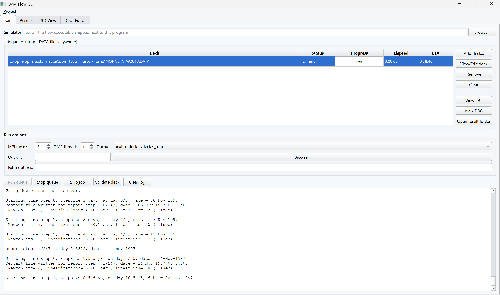
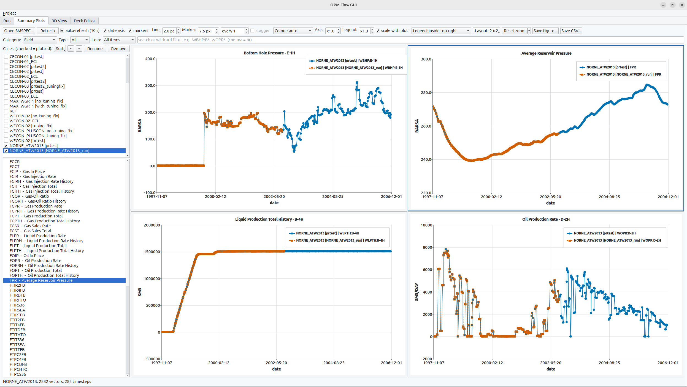
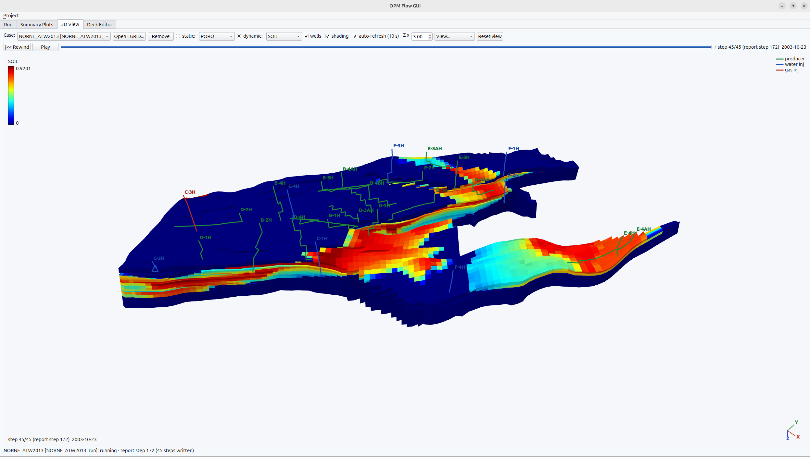
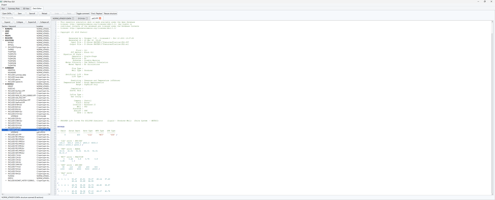

OPM Flow for Windows, built from OPM master of the evening of 24 November 2026 — native MSVC build (hybrid MPI + OpenMP) with a Qt GUI workbench.

> **An unofficial build.** OPM Flow is developed by the [Open Porous Media initiative](https://opm-project.org). This is an independent Windows build of it, not a release of the OPM project, and OPM does not support it. Report anything wrong with *this package* here; anything you can also reproduce on Linux belongs upstream with OPM.

**A snapshot of OPM master, not an OPM release.** These packages are OPM master as of the evening of 24 November 2026 plus the Windows patches, and are named by that date; `.1` because [master-2026-11-24](https://github.com/GitPaean/opm_flow_windows/releases/tag/master-2026-11-24), built from the master of that morning, already has the name. `flow --version` reports the development version master carried that day (2027.04-pre); that is OPM's label for master, not a version of these packages.

**Downloads** — the installer and the portable zip both work for most people; pick whichever you prefer. If you are on a **managed work laptop without administrator rights**, take the Intel MPI zip: it is the one that needs no administrator at any point.
- `OPM-Flow-master-2026-11-24.1-Setup.exe` — installer: adds Start-menu shortcuts, and installs over an earlier OPM Flow install, keeping its saved GUI settings. It can install **for one user without administrator rights** as well as machine-wide, so it at least runs on a managed laptop. The Visual C++ and OpenMP runtimes ship inside the package, so the only external prerequisite is **Microsoft MPI** (the simulator links `msmpi.dll`); the installer installs it for you when run as an administrator. Installing MS-MPI itself always needs an administrator, so a per-user install ends by telling you that and how — if you cannot get one, use the Intel MPI zip below instead. The graphical front end is a component of its own: *Simulator only* installs just `flow.exe` and the runtimes it needs, for a cluster login node or a scripted install.
- `opm-flow-master-2026-11-24.1-win64.zip` — portable: unzip and run `bin\flow-gui.exe`. The Visual C++ and OpenMP runtimes are already in `bin\`; the only thing you might need is **Microsoft MPI** — if it isn't already installed, run `redist\msmpisetup.exe` once (or `winget install Microsoft.msmpi`).
- `opm-flow-master-2026-11-24.1-impi-win64.zip` — **the no-administrator option**, built against the Intel® MPI Library instead of MS-MPI. Unzip it anywhere you can write, then install the MPI runtime once *as yourself*:
  ```
  python -m pip install --user impi-rt
  ```
  That needs no administrator rights, where installing MS-MPI does — which is what otherwise blocks a locked-down machine, since the simulator links an MPI library even for serial runs. `flow-gui.exe` finds that runtime by itself; from a terminal use `bin\flow-impi.cmd DECK.DATA --output-dir=out`, or `bin\flow-impi.cmd -n 4 DECK.DATA ...` to run on 4 ranks. The MPI runtime is **not** bundled: OPM Flow is GPLv3 and Intel MPI is proprietary, so shipping them together raises a licensing question this package does not try to answer.
- `OPM-Flow-2026.11.24.1.msix` — unsigned MSIX (for sideloading/Store experiments; see PACKAGING.md); its version is the snapshot's date, since an MSIX version has to be numeric, and it installs as an upgrade over `2026.11.24.0`. **Note:** Windows will not enable its **Install** button unless the signing certificate is already trusted on the machine (it shows *"Publisher: Unknown / this app package's certificate could not be verified"*).
- No Linux package: on Linux, build flow-gui from source and bring your own `flow` — see the **Linux** section below.

**Contents:** `flow.exe` (all model variants, including black-oil; built from OPM master of 24 November 2026 plus the Windows patches) and `flow-gui.exe` **0.9.0**.

**New since [master-2026-11-24](https://github.com/GitPaean/opm_flow_windows/releases/tag/master-2026-11-24)**
- **OPM master of the evening instead of the morning**: 47 more upstream commits, among them opm-grid's conforming LGR refinement (serial), a faster ZCORN append in opm-grid, and GPU support for opm-common's `DryGasPvt`.
- **A smaller Windows patch series.** It is now built from the `windows` branches that carry only what Visual Studio 2026 needs. Three workarounds for older compilers are gone, so a little more of what you run is plain OPM master. [PATCHES.md](https://github.com/GitPaean/opm_flow_windows/blob/master/PATCHES.md) says which, and why.
- flow-gui is the same **0.9.0**; see the [master-2026-11-24 notes](https://github.com/GitPaean/opm_flow_windows/releases/tag/master-2026-11-24) for what is new in it and everything else since master-2026-10-12.

flow-gui is cross-platform: the same sources build on Windows, Linux and macOS, and on Linux you build it yourself, with the recipe below.

**Linux**

- **Bring your own simulator** — unlike the Windows packages, there is no `flow` for Linux here. Install or build OPM Flow following [opm-project.org](https://opm-project.org/?page_id=36) (e.g. the OPM binary packages: `sudo apt install mpi-default-bin opm-simulators`), then point the *Simulator:* field on the Run tab at it once (e.g. `/usr/bin/flow` or your own `.../opm-simulators/bin/flow`) — remembered between sessions.
- **Build flow-gui yourself** — it is a small standard CMake + Qt 6 project (Ubuntu shown):
  ```bash
  sudo apt install qt6-base-dev qt6-charts-dev libfmt-dev cmake ninja-build g++
  git clone https://github.com/GitPaean/opm_flow_windows
  cmake -S opm_flow_windows/flow-gui -B build-gui -DCMAKE_BUILD_TYPE=Release \
        -DFLOWGUI_OPM_PREFIX=<opm-common install prefix>
  cmake --build build-gui
  ```
  The Summary Plots, Compare, 3D View and Well Hierarchy tabs need an opm-common install prefix at configure time (watch for `flow-gui summary plotting: ON`, `3D viewer: ON` and `deck model (group tree / network): ON`); without it you still get the Run tab and deck editor. Full recipe including the opm-common step: [flow-gui/README.md → Building → Linux](https://github.com/GitPaean/opm_flow_windows/blob/master/flow-gui/README.md#linux).

**Screenshots** (Norne benchmark case)

| Run queue | Results & case comparison |
|---|---|
|  |  |
| **3D viewer** | **Deck editor** |
|  |  |

**Getting past SmartScreen (this build is unsigned)**
The binaries are not code-signed, so Windows shows *reputation* warnings — these are not virus detections, and for the `.exe`/`.zip` they are dismissible:
- **When downloading** (Edge/Chrome): if it says *"… isn't commonly downloaded"* and the download stops or shows **Canceled**, open the download's **⋯ (More actions)** menu → **Keep**, then **Keep anyway**.
- **On first launch**: if *"Windows protected your PC"* appears, click **More info → Run anyway**.

**Notes**
- Windows 10/11 x64.
- Parallel runs, MS-MPI package: `mpiexec -n <ranks> flow.exe DECK.DATA --threads-per-process=<threads> --output-dir=<dir>`, or use the GUI.
- Parallel runs, **Intel MPI package**: use `bin\flow-impi.cmd -n <ranks> DECK.DATA ...`, or the GUI. Not a bare `mpiexec` — if MS-MPI is also installed that name resolves to *its* launcher, which cannot start an Intel MPI binary and fails with `unable to decode hostport …  PMI_Init returned -1`. `flow-impi.cmd` and the GUI both pick the right launcher for you.
- OPM Flow is developed by the [Open Porous Media initiative](https://opm-project.org) ([github.com/OPM](https://github.com/OPM)) under GPLv3+. These binaries include a small set of Windows/MSVC patches maintained in the forks below; the complete corresponding source is the upstream OPM repositories plus the Windows patches on the `windows` branch of [opm-common](https://github.com/GitPaean/opm-common/tree/windows), [opm-grid](https://github.com/GitPaean/opm-grid/tree/windows) and [opm-simulators](https://github.com/GitPaean/opm-simulators/tree/windows). The package's `LICENSE.txt` names the exact **commit** each binary was built from rather than a branch, so it stays correct as the branches move on. The build harness and flow-gui are Copyright (C) 2026 SINTEF Digital, Mathematics & Cybernetics, GPLv3+.
